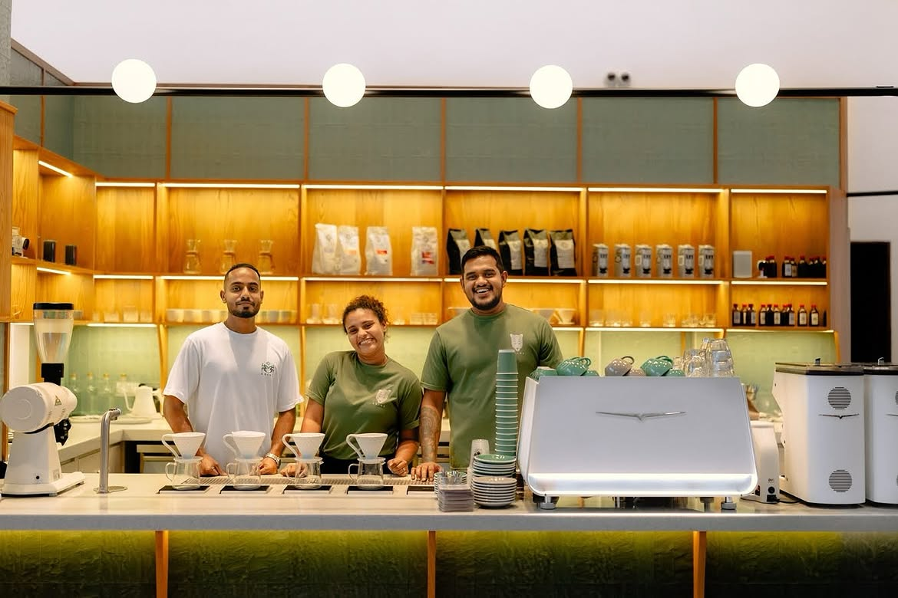

# The Grind LK — Specialty Café & Coffee Atelier

A modern, responsive, high-performance web experience for **The Grind LK**, Colombo's artisanal specialty coffee café.



## ✦ Highlights & Features

- **Cinematic Video Preloader**: Atmospheric opening video introduction featuring fresh coffee pours with sound toggle and tap-to-dismiss.
- **Deep Espresso Obsidian Design**: Luxury gold & warm dark coffee color palette with glassmorphism and subtle micro-animations.
- **Scroll-Driven Horizontal Carousels**: 
  - Experience specialties card carousel (`.cards-grid`)
  - Live Instagram Reels video strip (`.video-reels-grid`) with responsive touch dragging and scroll synchronization.
- **Artisanal Specialty Menu**: Filterable menu categories highlighting single-origin espressos, ceremonial Uji matcha, and hearth-baked bagels.
- **Rich Mobile Experience**: Optimized mobile navigation drawer, fluid touch interactions, and verified trust credentials.

## 🛠 Tech Stack

- **HTML5**: Semantic markup, Open Graph tags, accessibility attributes.
- **Vanilla CSS3**: Modern flexbox/grid architecture, CSS variables, glassmorphic filters, and fluid typography.
- **Vanilla JavaScript**: Lightweight custom scroll-driven animation engine, video reel audio controllers, and mobile drawer managers.

## ☕ Getting Started Locally

To run the café site locally:

```bash
# Using Python
python -m http.server 4321

# Or using Node (http-server / live-server)
npx http-server -p 4321
```

Then open `http://localhost:4321` in your browser.

---

Crafted with care in Colombo, Sri Lanka &bull; © 2026 The Grind LK.